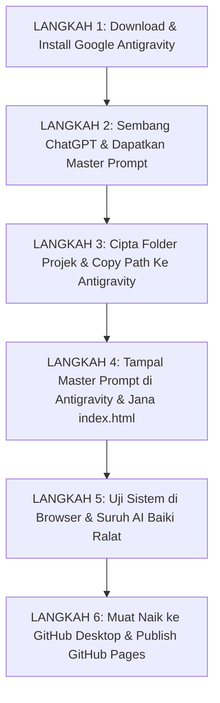

# 🚀 MANUAL OPERASI LENGKAP GOOGLE ANTIGRAVITY (EDISI PENGGUNA NON-CODER)
### Panduan Manual Step-by-Step SOP Membina & Menerbitkan Sistem/Website Tanpa Pengetahuan Coding

---

## 📌 Isi Kandungan Master Manual

1. [Bab 1 – Pengenalan & Gambaran Keseluruhan Alur Kerja (SOP Manual)](#bab-1--pengenalan--gambaran-keseluruhan-alur-kerja-sop-manual)
2. [Bab 2 – Manual Pemasangan & Persediaan Google Antigravity](#bab-2--manual-pemasangan--persediaan-google-antigravity)
3. [Bab 3 – Manual Bersembang Dengan ChatGPT Untuk Menjana Master Prompt](#bab-3--manual-bersembang-dengan-chatgpt-untuk-menjana-master-prompt)
4. [Bab 4 – Manual Menyediakan Folder Projek & Menyalin Pautan (Copy Path)](#bab-4--manual-menyediakan-folder-projek--menyalin-pautan-copy-path)
5. [Bab 5 – Manual Menjana Fail Sistem di Google Antigravity](#bab-5--manual-menjana-fail-sistem-di-google-antigravity)
6. [Bab 6 – Manual Semakan & Ujian Visual (Testing & Feedback Loop)](#bab-6--manual-semakan--ujian-visual-testing--feedback-loop)
7. [Bab 7 – Koleksi Master Prompt Siap Guna (5 Jenis Sistem Utama)](#bab-7--koleksi-master-prompt-siap-guna-5-jenis-sistem-utama)
8. [Bab 8 – Tutorial Manual 1: Bina Landing Page Perniagaan Katering](#bab-8--tutorial-manual-1-bina-landing-page-perniagaan-katering)
9. [Bab 9 – Tutorial Manual 2: Bina Sistem Kehadiran & Borang Data](#bab-9--tutorial-manual-2-bina-sistem-kehadiran--borang-data)
10. [Bab 10 – Tutorial Manual 3: Bina Admin Dashboard Analitik Visual](#bab-10--tutorial-manual-3-bina-admin-dashboard-analitik-visual)
11. [Bab 11 – Manual Menyelesaikan Ralat & Masalah Lazim (Troubleshooting Guide)](#bab-11--manual-menyelesaikan-ralat--masalah-lazim-troubleshooting-guide)
12. [Bab 12 – Manual Pendaftaran Akaun GitHub & GitHub Desktop](#bab-12--manual-pendaftaran-akaun-github--github-desktop)
13. [Bab 13 – Manual Memindahkan Projek Dari Antigravity Ke GitHub Desktop](#bab-13--manual-memindahkan-projek-dari-antigravity-ke-github-desktop)
14. [Bab 14 – Manual Menerbitkan Live Web URL (GitHub Pages)](#bab-14--manual-menerbitkan-live-web-url-github-pages)
15. [Bab 15 – Manual Mengemas Kini & Menjaga Laman Web Masa Hadapan](#bab-15--manual-mengemas-kini--menjaga-laman-web-masa-hadapan)

---

# Bab 1 – Pengenalan & Gambaran Keseluruhan Alur Kerja (SOP Manual)

## 1.1 Panduan Manual Operasi Pengguna Non-Coder
Selamat datang ke **Manual Operasi Google Antigravity**. Manual ini ditulis secara khusus sebagai rujukan rasmi **Langkah demi Langkah (Step-by-Step SOP Manual)** bagi pengguna yang:
- **TIDAK PERNAH belajar coding atau pengaturcaraan perisian**.
- **TIDAK TAHU tentang istilah teknikal** seperti backend, frontend, database, HTML, CSS, JavaScript, atau server.
- Ingin membina sistem, laman web, borang pendaftaran, atau dashboard perniagaan sendiri daripada idea hingga boleh diakses awam di internet.



---

# Bab 2 – Manual Pemasangan & Persediaan Google Antigravity

1. Buka pelayar web & layari `https://antigravity.google/download`.
2. Muat turun fail installer (`AntigravitySetup-x64.exe`).
3. Dwi-klik setup wizard & tekan Next hingga Finish.
4. Klik **Log in with Google** di Antigravity dan benarkan akses akaun.

---

# Bab 3 – Manual Bersembang Dengan ChatGPT Untuk Menjana Master Prompt

### Templat Prompt Generator:
```text
Saya mahu membina [SISTEM/WEBSITE/DASHBOARD ANDA]. Saya tiada latar belakang coding langsung. 
Tolong buatkan satu Master Prompt yang sangat lengkap dan terperinci untuk saya tampal ke dalam Google Antigravity. 
Mesti mengandungi fail paparan utama `index.html` dengan Tailwind CSS yang cantik.
```

---

# Bab 4 – Manual Menyediakan Folder Projek & Menyalin Pautan (Copy Path)

1. Cipta folder baharu di komputer (contoh: `C:\antigravity\SistemKehadiran`).
2. Klik kanan folder > pilih **Copy as path** (Salin pautan folder).
3. Buka Antigravity > klik **Open Workspace** > tampal pautan folder tersebut.

---

# Bab 5 – Manual Menjana Fail Sistem di Google Antigravity

1. Tampal Master Prompt daripada ChatGPT ke ruangan perbualan utama Antigravity.
2. Tekan Enter / Send.
3. Antigravity secara automatik membina fail utama `index.html` di latar belakang.

---

# Bab 6 – Manual Semakan & Ujian Visual (Testing & Feedback Loop)

1. Dwi-klik fail **`index.html`** di folder komputer anda untuk membuka di browser.
2. Uji borang & butang.
3. Jika ada ralat, suruh Antigravity baiki secara automatik:
   `"Saya dah uji index.html di browser. Bila saya tekan butang 'Simpan', data tidak muncul dalam jadual. Tolong baiki fungsi butang Simpan ini supaya ia menyimpan data 100%."`

---

# Bab 7 – Koleksi Master Prompt Siap Guna (5 Jenis Sistem Utama)

### Master Prompt 1: Landing Page Perniagaan
```text
Bina sebuah Landing Page moden untuk "Perkhidmatan AI Automasi" di index.html menggunakan Tailwind CSS CDN. Sertakan Hero Section, 3 Kad Ciri Utama, Jadual Harga 3 Pakej, dan Borang Pertanyaan Pelanggan.
```

---

# Bab 8 – Tutorial Manual 1: Bina Landing Page Perniagaan Katering

1. Cipta folder `C:\antigravity\LandingPageKatering`.
2. Buka folder di Antigravity & tampal Master Prompt Katering.
3. Dwi-klik fail `index.html` di komputer anda.

---

# Bab 9 – Tutorial Manual 2: Bina Sistem Kehadiran & Borang Data

1. Cipta folder `C:\antigravity\SistemBorang`.
2. Tampal Master Prompt Sistem Borang Pendaftaran.
3. Dwi-klik `index.html`, isi borang, dan tekan Simpan.

---

# Bab 10 – Tutorial Manual 3: Bina Admin Dashboard Analitik Visual

1. Cipta folder `C:\antigravity\AdminDashboard`.
2. Tampal Master Prompt Admin Dashboard Analitik.
3. Dwi-klik `index.html` untuk melihat carta analitik visual.

---

# Bab 11 – Manual Menyelesaikan Ralat & Masalah Lazim (Troubleshooting Guide)

- **Punca Butang Tak Function**: Tampal arahan repair prompt ke Antigravity.
- **Punca Data Hilang Bila Refresh**: Tampal arahan minta simpan di `localStorage`.

---

# Bab 12 – Manual Pendaftaran Akaun GitHub & GitHub Desktop

1. Buat akaun di `https://github.com/signup`.
2. Download GitHub Desktop di `https://desktop.github.com/`.
3. Log masuk akaun di GitHub Desktop.

---

# Bab 13 – Manual Memindahkan Projek Dari Antigravity Ke GitHub Desktop

1. Buka GitHub Desktop > File > Add Local Repository.
2. Pilih folder projek Antigravity anda di komputer.
3. Tekan Publish Repository ke GitHub.com.

---

# Bab 14 – Manual Menerbitkan Live Web URL (GitHub Pages)

1. Tekan View on GitHub di GitHub Desktop.
2. Di GitHub.com > Settings > Pages > tukar Branch ke `main` -> Save.
3. Dapatkan Live URL awam anda (`https://username.github.io/nama-projek/`).

---

# Bab 15 – Manual Mengemas Kini & Menjaga Laman Web Masa Hadapan

1. Kemas kini di Antigravity -> Commit di GitHub Desktop -> Live Auto-Update di internet!

---
*Tamat Manual Operasi Google Antigravity.*
