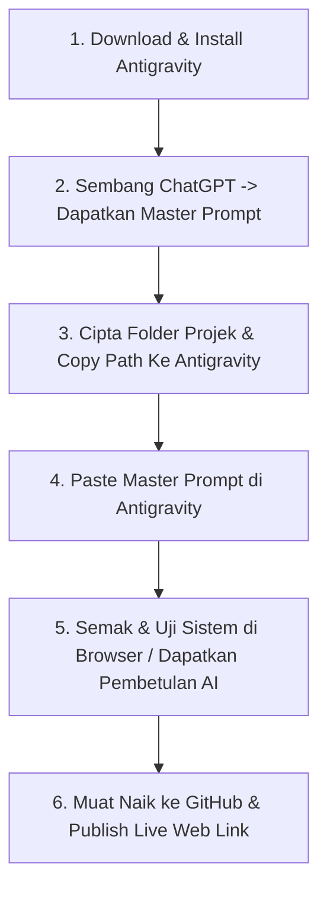

# 📘 Playbook Google Antigravity (Edisi Pengguna Non-Coder / Tanpa Pengetahuan Coding)

Selamat datang ke **Playbook Google Antigravity**! E-book ini direka khas untuk **pengguna yang tidak tahu langsung pasal coding** (tiada latar belakang pengaturcaraan, tidak faham backend, frontend, atau pangkalan data).

Dengan playbook ini, anda hanya perlu tahu **bersembang dengan ChatGPT**, **menyalin pautan folder**, **menampal arahan di Antigravity**, dan **menerbitkan sistem anda ke awam menerusi GitHub**!

---

## 🔄 Alur Kerja Ringkas 6 Langkah Utama

---

## 📂 Struktur Kandungan Playbook (15 Bab)

| Bab | Tajuk Bab | Ringkasan Proses |
| :--- | :--- | :--- |
| **Bab 1** | [Pengenalan Antigravity Untuk Non-Coder](bab/bab01_pengenalan.md) | Kenapa orang tak tahu coding boleh bina sistem dengan Antigravity. |
| **Bab 2** | [Muat Turun & Pemasangan Antigravity](bab/bab02_antigravity2.md) | Cara download, install & log masuk akaun Google Antigravity. |
| **Bab 3** | [Sembang ChatGPT Untuk Dapatkan Master Prompt](bab/bab03_interface.md) | Cara bersembang dengan ChatGPT untuk jana Master Prompt lengkap. |
| **Bab 4** | [Penyediaan Folder Projek & Pautan Lokasi](bab/bab04_instalasi.md) | Cipta folder di komputer & paste link folder ke Antigravity. |
| **Bab 5** | [Pelancaran Master Prompt di Antigravity](bab/bab05_cara_agent_berfungsi.md) | Tampal Master Prompt & biarkan Antigravity bina sistem otonom. |
| **Bab 6** | [Panduan Semakan & Pengujian Sistem](bab/bab06_prompt_engineering.md) | Buka fail `index.html`, uji butang/borang & bagi arahan repair. |
| **Bab 7** | [Koleksi Master Prompt Siap Guna](bab/bab07_bina_website.md) | 50+ Master Prompt siap guna untuk pelbagai jenis sistem. |
| **Bab 8** | [Tutorial 1: Bina Landing Page / Laporan](bab/bab08_bina_sistem.md) | Langkah demi langkah bina laman web maklumat/laporan. |
| **Bab 9** | [Tutorial 2: Bina Sistem Borang & Data](bab/bab09_browser_automation.md) | Langkah demi langkah bina borang pendaftaran & simpanan data. |
| **Bab 10** | [Tutorial 3: Bina Admin Dashboard Interaktif](bab/bab10_cli.md) | Langkah demi langkah bina dashboard analisa & carta visual. |
| **Bab 11** | [Pengurusan Ralat & Pembetulan Automatik](bab/bab11_sdk.md) | Cara suruh Antigravity baiki butang rosak / skrin kosong. |
| **Bab 12** | [Persediaan Akaun GitHub & GitHub Desktop](bab/bab12_artifacts.md) | Buat akaun GitHub & download alatan visual GitHub Desktop. |
| **Bab 13** | [Memindahkan Projek Dari Antigravity Ke GitHub](bab/bab13_workflow_profesional.md) | Langkah demi langkah muat naik fail projek ke GitHub. |
| **Bab 14** | [Menerbitkan Sistem Ke Awam (GitHub Pages)](bab/bab14_perbandingan.md) | Cara dapatkan pautan laman web awam (*Live Web Link*). |
| **Bab 15** | [Amalan Terbaik & Petua Menguruskan Projek AI](bab/bab15_masadepan.md) | Petua menjaga sistem & mengemas kini maklumat masa depan. |

---

## 🌐 Cara Membaca Playbook Ini
- 🌐 **Laman Web Interaktif**: [`index.html`](index.html) (Boleh dibuka di browser)
- 📄 **Master Document**: [`PLAYBOOK_GOOGLE_ANTIGRAVITY.md`](PLAYBOOK_GOOGLE_ANTIGRAVITY.md)
