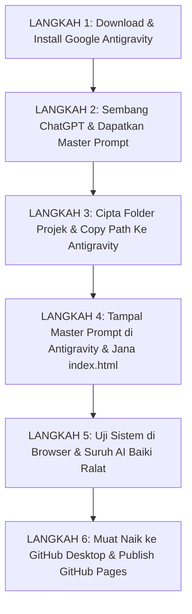

# Bab 1 – Pengenalan & Gambaran Keseluruhan Alur Kerja (SOP Manual)

## 1.1 Panduan Manual Operasi Pengguna Non-Coder
Selamat datang ke **Manual Operasi Google Antigravity**. Manual ini ditulis secara khusus sebagai rujukan rasmi **Langkah demi Langkah (Step-by-Step SOP Manual)** bagi pengguna yang:
- **TIDAK PERNAH belajar coding atau pengaturcaraan perisian**.
- **TIDAK TAHU tentang istilah teknikal** seperti backend, frontend, database, HTML, CSS, JavaScript, atau server.
- Ingin membina sistem, laman web, borang pendaftaran, atau dashboard perniagaan sendiri daripada idea hingga boleh diakses awam di internet.

---

## 1.2 Peranan Anda vs Peranan Google Antigravity

| Peranan Anda (Pengurus Projek / Pemikir Idea) | Peranan Google Antigravity (Jurutera AI Peribadi) |
| :--- | :--- |
| 1. Memikirkan idea sistem / web yang mahu dibina. | 1. Membaca arahan Master Prompt anda. |
| 2. Bersembang dengan ChatGPT untuk dapatkan Master Prompt. | 2. Menulis fail kod perisian (`index.html`) secara otonom. |
| 3. Menyediakan folder projek di komputer & salin pautan (*copy path*). | 3. Menyusun susun atur borang, jadual, dan butang. |
| 4. Menampal Master Prompt ke Antigravity. | 4. Membaiki ralat automatik apabila anda minta pembetulan. |
| 5. Menguji butang & borang di pelayar web (Chrome/Edge). | 5. Menyediakan struktur fail yang sedia diterbitkan ke GitHub. |
| 6. Muat naik projek ke GitHub menerusi GitHub Desktop. | 6. Memastikan semua fungsi berfungsi mengikut keperluan. |

---

## 1.3 Carta Alir Manual Operasi 6 Langkah Utama (SOP)

---

## 1.4 Glosari Istilah Ringkas (Tanpa Jargon Teknikal)

* **Google Antigravity**: Perisian AI di komputer anda yang bertindak sebagai jurutera pembuat perisian automatik.
* **ChatGPT**: Chatbot AI percuma di pelayar web yang membantu anda menterjemah idea ke dalam bentuk arahan bertulis terperinci (*Master Prompt*).
* **Master Prompt**: Teks arahan lengkap dan terperinci yang dimasukkan ke dalam Antigravity untuk membina sistem.
* **`index.html`**: Fail utama paparan laman web/sistem anda yang boleh dibuka di pelayar Chrome atau Edge.
* **Copy Path (Salin Pautan Folder)**: Tindakan menyalin alamat lokasi folder di komputer anda supaya Antigravity tahu di mana mahu menyimpan fail.
* **GitHub & GitHub Desktop**: Perkhidmatan percuma untuk memuat naik fail sistem anda dari komputer ke internet supaya orang ramai boleh membuka laman web anda melalui pautan awam (*Live URL*).
* **GitHub Pages**: Ciri di GitHub yang menukarkan fail projek anda menjadi pautan laman web awam (`https://username.github.io/projek/`).

---
*Gunakan bar navigasi tab di atas untuk meneruskan ke Bab 2.*
