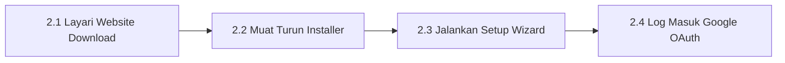

# Bab 2 – Manual Pemasangan & Persediaan Google Antigravity

Bab ini menyediakan panduan manual **Langkah demi Langkah (Step-by-Step Manual)** untuk memuat turun, memasang, dan mengaktifkan perisian Google Antigravity di komputer anda.

---

## 2.1 Alur Kerja Pemasangan

---

## 2.2 Manual Operasi Pemasangan Terperinci

### 📍 Langkah 2.1: Layari Portal Rasmi Muat Turun
1. Buka pelayar web di komputer anda (contoh: **Google Chrome** atau **Microsoft Edge**).
2. Di bar alamat atas, taip: `https://antigravity.google/download` dan tekan **Enter**.
3. Laman web rasmi Google Antigravity akan dipaparkan.

### 📍 Langkah 2.2: Muat Turun Fail Installer
1. Di halaman muat turun, klik pada butang biru utama:
   - Jika anda guna **Windows**: Klik **Download for Windows (.exe)**.
   - Jika anda guna **Mac**: Klik **Download for macOS (.dmg)**.
2. Fail installer akan dimuat turun secara automatik ke dalam folder `Downloads` komputer anda.

### 📍 Langkah 3.3: Jalankan Setup Wizard Pemasangan
1. Buka **File Explorer** (Windows) atau **Finder** (Mac).
2. Pergi ke folder **Downloads**.
3. Dwi-klik (*double-click*) pada fail installer yang baru dimuat turun (contoh: `AntigravitySetup-x64.exe`).
4. Sekiranya paparan amaran *Windows Protected Your PC* atau *User Account Control* muncul, klik **Yes** / **Run Anyway**.
5. Di skrin Setup Wizard:
   - Klik **Next** -> Klik **Install**.
   - Biarkan proses pemasangan berjalan (mengambil masa kira-kira 1-2 minit).
   - Klik **Finish** apabila pemasangan selesai.
6. Perisian **Google Antigravity** akan dilancarkan di skrin komputer anda.

### 📍 Langkah 2.4: Log Masuk Akaun Google (OAuth Authentication)
1. Apabila perisian Antigravity dibuka buat kali pertama, anda akan melihat skrin Selamat Datang (*Welcome Screen*).
2. Klik pada butang biru: **"Log in with Google"**.
3. Pelayar web Chrome/Edge anda akan dibuka secara automatik.
4. Pilih akaun Google anda (e-mel Gmail anda).
5. Klik **Allow / Benarkan** untuk membenarkan Antigravity berinteraksi dengan akaun anda.
6. Pelayar web akan memaparkan mesej **"Authentication Successful! You can close this window."**
7. Tutup pelayar web tersebut dan kembali ke perisian Antigravity. Anda kini bersedia untuk menggunakan Antigravity!

---
*Teruskan ke Bab 3 untuk belajar cara mendapatkan Master Prompt daripada ChatGPT.*
