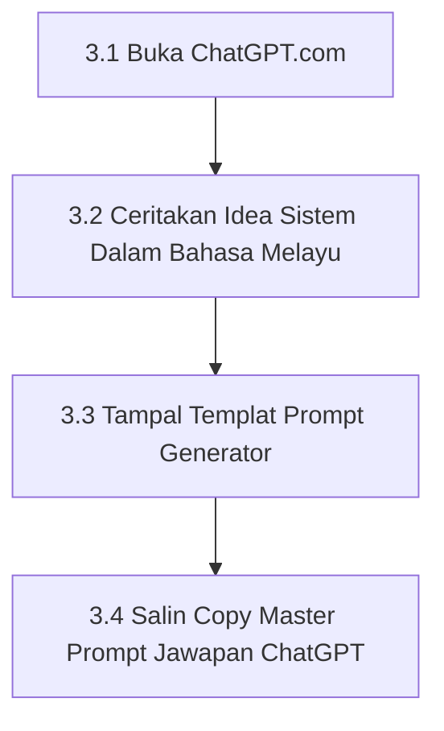

# Bab 3 – Manual Bersembang Dengan ChatGPT Untuk Menjana Master Prompt

Sebelum anda membuka Google Antigravity untuk membina sebarang sistem, anda memerlukan **Master Prompt** (teks arahan lengkap). Kaedah paling mudah dan berkesan ialah dengan **bersembang dengan ChatGPT**.

---

## 3.1 Alur Kerja Penjanaan Master Prompt



---

## 3.2 Manual Operasi Bersembang Dengan ChatGPT Terperinci

### 📍 Langkah 3.1: Buka Laman Web ChatGPT
1. Buka pelayar web Chrome/Edge anda.
2. Taip alamat: `https://chatgpt.com` dan tekan **Enter**.
3. Jika anda belum ada akaun, klik **Sign up** (percuma) menggunakan akaun Google anda. Jika sudah ada, klik **Log in**.

### 📍 Langkah 3.2: Ceritakan Idea Sistem Anda Kepada ChatGPT
Gunakan Bahasa Melayu harian biasa. Beritahu ChatGPT apa yang anda mahu bina. 

**Contoh Teks Perbualan:**
> *"Salam ChatGPT, saya nak buat satu Sistem Kehadiran Staf untuk kedai saya. Saya nak ada tempat isi nama staf, tarikh, waktu masuk, dan status (Hadir/Cuti). Reka bentuk nak warna biru gelap dan moden. Boleh tak awak buatkan satu Master Prompt yang sangat terperinci untuk saya masukkan ke Google Antigravity?"*

### 📍 Langkah 3.3: Templat Master Prompt Universal (Salin Teks Ini Ke Google Antigravity)
Salin teks di dalam kotak di bawah dan tampal terus ke dalam perbualan Google Antigravity:

```text
Saya mahu membina [NYATAKAN NAMA SISTEM/WEBSITE/DASHBOARD ANDA DI SINI]. 
Saya tiada latar belakang coding langsung.

Tolong buatkan satu Master Prompt yang sangat lengkap, terperinci, dan tersusun untuk saya salin dan tampal ke dalam Google Antigravity.

Master Prompt tersebut mesti meminta Antigravity untuk:
1. Membina fail paparan utama `index.html` menggunakan Tailwind CSS CDN dengan reka bentuk moden berasaskan Mod Gelap (Dark Mode).
2. Menyediakan borang input maklumat dan semua butang (seperti Butang Simpan, Hantar, dan Padam) yang berfungsi 100%.
3. Menyimpan semua data yang dimasukkan ke dalam memori tempatan pelayar (localStorage) supaya data tidak hilang apabila halaman di-refresh.
4. Memastikan paparan kelihatan kemas dan mesra pengguna di skrin telefon bimbit serta komputer.
```

### 📍 Langkah 3.4: Salin (*Copy*) Master Prompt Jawapan ChatGPT
1. Selepas ChatGPT menjawab dan memaparkan kotak arahan Master Prompt.
2. Gerakkan tetikus ke atas kotak jawapan ChatGPT tersebut.
3. Klik ikon **Copy** (dua segi empat bertindih) di penjuru bawah jawapan ChatGPT, atau sorot (*highlight*) semua teks arahan tersebut dan tekan `Ctrl+C`.
4. Teks Master Prompt kini tersimpan di papan keratan (*clipboard*) komputer anda!

---
*Teruskan ke Bab 4 untuk menyediakan folder simpanan di komputer anda.*
