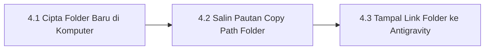

# Bab 4 – Manual Menyediakan Folder Projek & Menyalin Pautan (Copy Path)

Bab ini mengajar anda cara membuat folder khas di dalam komputer anda dan memasukkan pautan lokasi (*folder path*) tersebut ke dalam perisian Google Antigravity.

---

## 4.1 Alur Kerja Penyediaan Folder

---

## 4.2 Manual Operasi Penyediaan Folder Terperinci

### 📍 Langkah 4.1: Cipta Folder Projek Baharu
1. Buka **File Explorer** di Windows (atau **Finder** di Mac).
2. Pilih lokasi pemacu komputer anda (disyorkan di dalam pemacu `C:\` atau `Documents`).
3. Klik kanan di kawasan kosong > pilih **New** > **Folder**.
4. Namakan folder anda mengikut nama sistem anda tanpa menggunakan jarak jika boleh (contoh: `SistemKehadiran` atau `WebKatering`).
   *(Contoh laluan penuh folder: `C:\antigravity\SistemKehadiran`)*

### 📍 Langkah 4.2: Salin Pautan Folder (*Copy Path*)
* **Untuk Pengguna Windows**:
  1. Klik kanan pada folder `SistemKehadiran` yang baru anda cipta.
  2. Pilih menu **Copy as path** (Salin sebagai pautan).
  3. *(Atau klik pada bar alamat atas File Explorer dan tekan `Ctrl+C`)*.
* **Untuk Pengguna Mac**:
  1. Klik kanan pada folder.
  2. Tekan dan tahan kekunci `Option` di papan kekunci anda.
  3. Pilih **Copy "SistemKehadiran" as Pathname**.

### 📍 Langkah 4.3: Tampal Pautan Folder Ke Dalam Antigravity
1. Buka perisian **Google Antigravity**.
2. Di panel navigasi sebelah kiri, klik pada menu **Projects** atau butang **Open Workspace**.
3. Satu petak dialog carian lokasi folder akan muncul di skrin.
4. Klik pada petak alamat tersebut dan tekan `Ctrl+V` (atau klik kanan > Paste) untuk menampal pautan folder anda (contoh: `C:\antigravity\SistemKehadiran`).
5. Tekan **Enter** atau klik butang **Open**.
6. Google Antigravity kini sudah ditetapkan secara rasmi untuk menyimpan semua fail sistem di dalam folder projek tersebut!

---
*Teruskan ke Bab 5 untuk melancarkan Master Prompt.*
