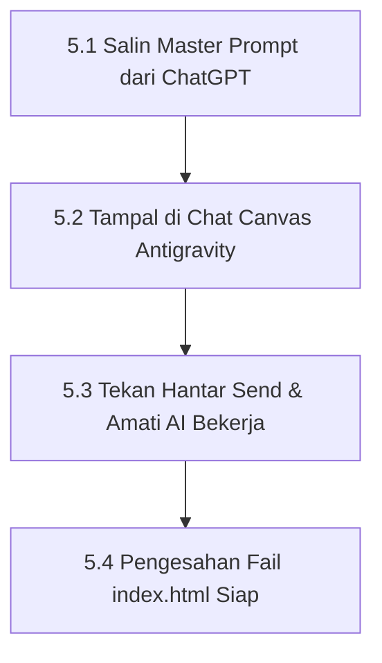

# Bab 5 – Manual Menjana Fail Sistem di Google Antigravity

Sekarang tiba masanya untuk membiarkan **Google Antigravity** membina keseluruhan fail sistem dan laman web anda secara automatik!

---

## 5.1 Alur Kerja Pelancaran Prompt

---

## 5.2 Manual Operasi Menjana Sistem Terperinci

### 📍 Langkah 5.1: Salin Master Prompt Daripada ChatGPT
1. Buka semula tetingkap ChatGPT anda di Bab 3.
2. Salin (*copy*) teks Master Prompt yang disediakannya (`Ctrl+C`).

### 📍 Langkah 5.2: Tampal ke Dalam Chat Canvas Antigravity
1. Buka perisian **Google Antigravity** (pastikan nama folder projek anda di Bab 4 kelihatan aktif di bahagian atas).
2. Klik pada ruangan input teks utama di bahagian bawah tengah (**Chat Canvas**).
3. Tekan `Ctrl+V` (atau klik kanan > Paste) untuk menampal Master Prompt tersebut.

### 📍 Langkah 5.3: Tekan Hantar & Amati AI Bekerja
1. Tekan kekunci `Enter` di papan kekunci anda (atau klik butang biru **Send / Hantar**).
2. Anda akan melihat Antigravity mula merancang, menganalisis, dan menulis kod perisian di latar belakang.
3. Di panel sebelah kanan (*Auxiliary Pane / Files Changed*), anda akan melihat fail utama seperti **`index.html`** dijana secara automatik.

### 📍 Langkah 5.4: Pengesahan Kejayaan Pembinaan
1. Apabila Antigravity berhenti menaip dan memaparkan mesej seperti *"Task complete"* atau *"System files generated successfully"*, ini menandakan pembinaan sistem anda telah 100% selesai!
2. Jangan tutup Antigravity lagi, buka Bab 6 untuk membuat semakan visual di pelayar web.

---
*Teruskan ke Bab 6 untuk membuat semakan dan pengujian sistem di browser.*
