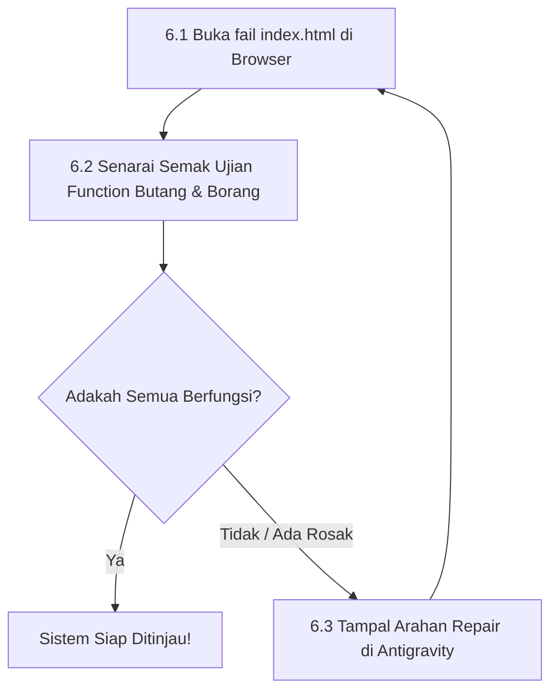

# Bab 6 – Manual Semakan & Ujian Visual (Testing & Feedback Loop)

Selepas Antigravity membina fail sistem anda, anda mesti menguji sama ada borang, butang, dan paparan berfungsi dengan betul di pelayar web anda.

---

## 6.1 Kitaran Semakan & Pembetulan (Feedback Loop)

---

## 6.2 Manual Operasi Pengujian Terperinci

### 📍 Langkah 6.1: Buka Fail `index.html` Di Pelayar Web
1. Buka folder projek anda di komputer (contoh: `C:\antigravity\SistemKehadiran`).
2. Cari fail yang bernama **`index.html`**.
3. Dwi-klik (*double click*) pada fail `index.html`. Fail tersebut akan dibuka secara terus di pelayar Chrome atau Edge anda.

### 📍 Langkah 6.2: Senarai Semak Ujian (Testing Checklist)
Semak 4 perkara ini di pelayar web anda:
1. **Paparan Visual**: Adakah tajuk, warna, dan susun atur kelihatan cantik dan tidak terabur?
2. **Input Borang**: Cuba taip nama, nombor telefon, atau e-mel ke dalam petak borang.
3. **Fungsi Butang**: Tekan butang **Simpan / Hantar**. Adakah data yang anda isi muncul di dalam jadual di bawah secara automatik?
4. **Ujian Refresh**: Tekan butang `F5` atau refresh halaman web. Adakah data yang anda simpan tadi masih kekal berada di skrin?

---

## 6.3 Cara Meminta Antigravity Membaiki Ralat (Jika Ada Butang Tak Function)

Sekiranya ada butang yang tidak bertindak atau data hilang, **JANGAN RISAU! Anda tidak perlu baiki kod**. 

Salin (*copy*) salah satu arahan pembetulan di bawah, sesuaikan masalah anda, dan tampal (*paste*) ke perbualan Antigravity:

### 💬 Templat Arahan Membaiki Ralat (Repair Prompts):
* 🔴 **Jika Butang Simpan Tidak Berfungsi**:
  `"Saya telah uji fail index.html di pelayar Chrome. Apabila saya tekan butang 'Simpan', tiada data yang dipaparkan di jadual bawah. Tolong baiki fungsi butang Simpan ini supaya ia menyimpan data 100%."`
* 🔴 **Jika Borang Tidak Dikeras/Dikosongkan Selepas Hantar**:
  `"Selepas saya tekan butang Hantar, teks dalam petak borang masih ada dan tidak padam. Tolong baiki supaya borang dikosongkan secara automatik selepas dihantar."`
* 🔴 **Jika Data Hilang Bila Refresh**:
  `"Bila saya muat semula (refresh) halaman web, data yang saya simpan tadi telah hilang. Tolong simpan data tersebut ke dalam localStorage supaya ia kekal."`
* 🔴 **Jika Paparan Terabur Di Telefon**:
  `"Tampilan borang kelihatan bertindih di skrin telefon bimbit. Tolong kemaskan reka bentuk Tailwind CSS supaya mesra skrin telefon."`

---
*Teruskan ke Bab 7 untuk melihat koleksi Master Prompt siap guna.*
