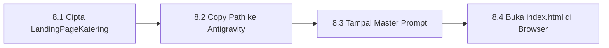

# Bab 8 – Tutorial Manual 1: Bina Landing Page Perniagaan Katering

Bab ini membimbing anda **Langkah demi Langkah (Step-by-Step Manual)** membina laman web Landing Page perniagaan katering pertama anda dari mula hingga siap di browser!

---

## 8.1 Alur Kerja Pembinaan



---

## 8.2 Panduan Langkah demi Langkah

### 📍 Langkah 8.1: Cipta Folder Projek
1. Buka File Explorer / Finder di komputer anda.
2. Pergi ke pemacu `C:\antigravity\`.
3. Klik kanan > **New Folder** > namakan folder: **`LandingPageKatering`**.

### 📍 Langkah 8.2: Salin Pautan & Buka di Antigravity
1. Klik kanan pada folder `LandingPageKatering` > pilih **Copy as path** (Salin pautan folder).
2. Buka perisian **Google Antigravity**.
3. Tampal (*paste*) pautan folder `C:\antigravity\LandingPageKatering` di bahagian Open Workspace.

### 📍 Langkah 8.3: Tampal Master Prompt Ini
Salin teks di bawah dan tampal ke dalam ruang perbualan Antigravity:
```text
Bina Landing Page perniagaan "Katering Enak Rasa" di fail index.html.

Gunakan Tailwind CSS CDN dengan reka bentuk moden. 
Sertakan:
1. Header & Navbar dengan logo "Katering Enak Rasa" dan butang "Hubungi Kami".
2. Tajuk Utama: "Perkhidmatan Katering Majlis Perniagaan & Perkahwinan Terbaik".
3. 3 Kad Pakej Hidangan: Pakej Hemat (RM15/pax), Pakej Selera (RM25/pax), Pakej VIP (RM45/pax).
4. Borang Pertanyaan Tempahan: Nama, Nombor Telefon, Tarikh Majlis, dan Jumlah Tetamu.
5. Footer dengan lokasi pejabat dan pautan sosial media.
```

### 📍 Langkah 8.4: Semak Keputusan Di Pelayar Web
1. Buka folder `C:\antigravity\LandingPageKatering` di komputer anda.
2. Dwi-klik pada fail **`index.html`**.
3. Laman web katering anda kini siap dibuka dan boleh ditonton di pelayar Chrome atau Edge anda!

---
*Teruskan ke Bab 9 untuk tutorial pembinaan sistem borang data.*
