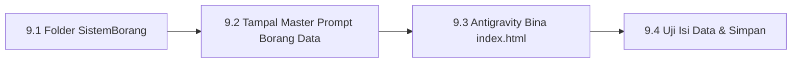

# Bab 9 – Tutorial Manual 2: Bina Sistem Kehadiran & Borang Data

Bab ini membimbing anda membina **Sistem Kehadiran Staf & Borang Data** tanpa menyunting sebaris kod pun!

---

## 9.1 Alur Kerja Pembinaan



---

## 9.2 Panduan Langkah demi Langkah

### 📍 Langkah 9.1: Sediakan Folder Projek
1. Cipta folder baharu di komputer anda: `C:\antigravity\SistemBorang`
2. Salin pautan folder tersebut (*Copy Path*) dan buka di Google Antigravity.

### 📍 Langkah 9.2: Tampal Master Prompt
Salin dan tampal Master Prompt ini ke perbualan Antigravity:
```text
Bina Sistem Pendaftaran Peserta Kursus di index.html.

Keperluan:
1. Borang pendaftaran: Nama Peserta, Nombor Telefon, E-mel, dan Pilihan Kategori (Pelajar / Pekerja / Usahawan).
2. Butang "Daftar Peserta".
3. Jadual di bawah borang yang menyimpan senarai peserta ke dalam localStorage secara kekal.
4. Butang "Padam Peserta" pada setiap baris jadual.
```

### 📍 Langkah 9.3: Uji Di Pelayar Web
1. Dwi-klik fail **`index.html`** di folder `C:\antigravity\SistemBorang`.
2. Isi maklumat nama dan e-mel, kemudian tekan **Daftar Peserta**.
3. Sahkan bahawa data yang dimasukkan terus dipaparkan di dalam jadual secara automatik!

---
*Teruskan ke Bab 10 untuk tutorial membina Admin Dashboard.*
