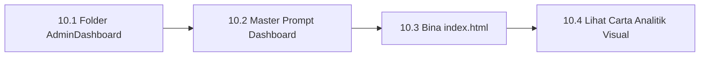

# Bab 10 – Tutorial Manual 3: Bina Admin Dashboard Analitik Visual

Bab ini membimbing anda membina **Admin Dashboard Analitik Jualan** yang lengkap dengan carta garisan dan kad statistik.

---

## 10.1 Alur Kerja Pembinaan



---

## 10.2 Panduan Langkah demi Langkah

### 📍 Langkah 10.1: Sediakan Folder Projek
1. Cipta folder baharu di komputer anda: `C:\antigravity\AdminDashboard`
2. Salin pautan folder (*Copy Path*) dan buka di Antigravity.

### 📍 Langkah 10.2: Tampal Master Prompt
Salin dan tampal Master Prompt ini ke perbualan Antigravity:
```text
Bina Admin Dashboard Pengurusan Kedai di index.html.

Keperluan:
1. Reka bentuk bernuansa Dark Mode menggunakan Tailwind CSS.
2. 4 Kad Statistik (KPI): Total Jualan (RM50,000), Pesanan (1,200), Pelanggan (850), Kadar Kejayaan (98%).
3. Carta Trend Jualan Bulanan menggunakan Chart.js CDN.
4. Jadual Transaksi Terkini dengan badge status warna (Hijau = Kejayaan, Kuning = Menunggu, Merah = Gagal).
```

### 📍 Langkah 10.3: Semak Keputusan Di Pelayar Web
1. Dwi-klik fail **`index.html`** di folder `C:\antigravity\AdminDashboard`.
2. Anda kini boleh melihat dashboard analitik yang lengkap dengan carta interaktif!

---
*Teruskan ke Bab 11 untuk belajar pengurusan ralat dan pembetulan automatik.*
