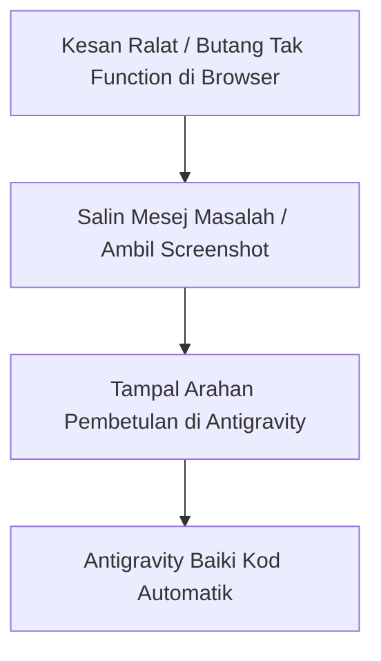

# Bab 11 – Manual Menyelesaikan Ralat & Masalah Lazim (Troubleshooting Guide)

Apabila anda membuka sistem di pelayar web, ada kalanya terdapat ralat seperti butang yang tidak berfungsi atau paparan yang terabur. Bab ini mengajar anda cara menyuruh Antigravity membaikinya secara automatik **tanpa anda menyentuh sebaris kod pun**!

---

## 11.1 Alur Membaiki Ralat



---

## 11.2 Panduan Menyelesaikan 5 Masalah Lazim

### 🔴 Masalah 1: Butang Simpan / Hantar Tidak Bertindak Apabila Ditekan
- **Punca**: Logik klik belum disambungkan dengan betul oleh AI.
- **Tindakan**: Tampal arahan ini di Antigravity:
  ```text
  Saya dah uji index.html di browser. Bila saya tekan butang 'Simpan', tiada apa yang berlaku dan data tidak dipaparkan. Tolong baiki fungsi butang Simpan ini supaya ia menyimpan data 100%.
  ```

### 🔴 Masalah 2: Data Hilang Apabila Halaman Di-Refresh
- **Punca**: AI terlupa menyimpan data ke dalam memori `localStorage`.
- **Tindakan**: Tampal arahan ini di Antigravity:
  ```text
  Bila saya refresh halaman web, semua data yang saya isi tadi telah hilang. Tolong baiki supaya semua data disimpan di dalam localStorage secara kekal.
  ```

### 🔴 Masalah 3: Tampilan Terabur Di Skrin Telefon Bimbit
- **Punca**: Susun atur CSS tidak disesuaikan dengan skrin kecil.
- **Tindakan**: Tampal arahan ini di Antigravity:
  ```text
  Paparan borang kelihatan terlalu rapat dan bertindih bila dibuka di skrin telefon. Tolong kemaskan reka bentuk Tailwind CSS supaya mesra skrin telefon bimbit.
  ```

### 🔴 Masalah 4: Skrin Putih Kosong
- **Punca**: Terdapat ralat sintaksis kecil pada fail HTML.
- **Tindakan**: Tampal arahan ini di Antigravity:
  ```text
  Fail index.html memaparkan skrin putih kosong di browser. Tolong imbas ralat di dalam kod dan baiki supaya paparan muncul semula dengan betul.
  ```

### 🔴 Masalah 5: Imej / Gambar Tidak Muncul
- **Punca**: Pautan gambar rosak.
- **Tindakan**: Tampal arahan ini di Antigravity:
  ```text
  Gambar di bahagian Hero Section tidak muncul. Tolong gantikan pautan imej tersebut dengan imej placeholder Unsplash yang sah.
  ```

---
*Teruskan ke Bab 12 untuk mula menyediakan akaun GitHub.*
