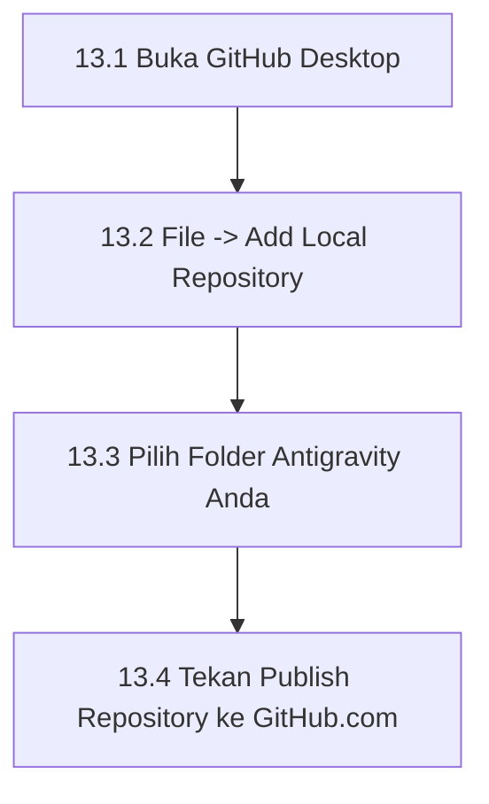

# Bab 13 – Manual Memindahkan Projek Dari Antigravity Ke GitHub Desktop

Bab ini menunjukkan cara memindahkan semua fail yang telah dijana oleh Antigravity ke dalam GitHub menggunakan GitHub Desktop secara visual.

---

## 13.1 Alur Kerja Memuat Naik Projek

---

## 13.2 Panduan Langkah demi Langkah

### 📍 Langkah 13.1: Tambah Folder Projek ke GitHub Desktop
1. Buka aplikasi **GitHub Desktop**.
2. Klik menu **File** (di bahagian atas kiri) > pilih **Add Local Repository...** (atau tekan `Ctrl+O`).
3. Klik **Choose...** dan pilih folder projek Antigravity anda di komputer (contoh: `C:\antigravity\LandingPageKatering`).
4. Jika muncul mesej *"This directory does not appear to be a Git repository"*, klik pautan **create a repository** di dalam dialog tersebut.

### 📍 Langkah 13.2: Cipta Repositori Baharu
1. Masukkan **Name** (contoh: `katering-enak-rasa`).
2. Klik butang **Create Repository**.

### 📍 Langkah 13.3: Muat Naik Ke GitHub.com (*Publish*)
1. Klik butang biru **Publish repository** di bahagian atas GitHub Desktop.
2. Nyah-tanda (*uncheck*) pilihan *"Keep this code private"* supaya laman web anda boleh diterbitkan secara awam percuma.
3. Klik **Publish Repository**.
4. Semua fail projek anda (termasuk `index.html`) kini telah selamat diunggah ke akaun GitHub anda!

---
*Teruskan ke Bab 14 untuk menerbitkan laman web anda secara awam.*
