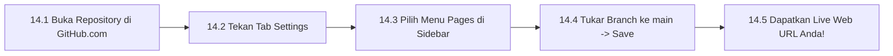

# Bab 14 – Manual Menerbitkan Live Web URL (GitHub Pages)

Ini adalah langkah kemuncak! Bab ini mengajar anda cara mengaktifkan **GitHub Pages** supaya projek anda mempunyai pautan web awam (*Live Web URL*) yang boleh dihantar kepada rakan, pelanggan, atau dibuka di media sosial!

---

## 14.1 Alur Kerja Menerbitkan Live Web Link

---

## 14.2 Langkah demi Langkah Mengaktifkan GitHub Pages

### 📍 Langkah 14.1: Buka Repositori di GitHub.com
1. Di dalam aplikasi **GitHub Desktop**, klik butang **View on GitHub** (atau tekan `Ctrl+Shift+G`).
2. Pelayar web anda akan membuka halaman repositori projek anda di GitHub.com.

### 📍 Langkah 14.2: Buka Tetapan (*Settings*)
1. Di bahagian atas halaman repositori, klik tab **Settings** (ikon roda gerigi).
2. Di menu sebelah kiri (*sidebar*), tatal ke bawah dan klik pada **Pages**.

### 📍 Langkah 14.3: Tetapkan Sumber Pelancaran (*Build and Deployment*)
1. Di bawah bahagian **Branch**, tukar daripada `None` kepada **`main`** (atau `master`).
2. Pastikan folder ditetapkan kepada **`/ (root)`**.
3. Klik butang **Save**.

### 📍 Langkah 14.4: Dapatkan Live URL Laman Web Anda!
1. Tunggu kira-kira 1 hingga 2 minit untuk GitHub memasang laman web anda.
2. Segarkan (*refresh*) halaman Settings > Pages tersebut.
3. Anda akan melihat kotak hijau dengan mesej:
   `Your site is live at https://username.github.io/nama-projek/`
4. **Tahniah!** Pautan ini kini boleh dibuka oleh sesiapa sahaja di seluruh dunia dari telefon bimbit atau komputer!

---
*Teruskan ke Bab 15 untuk petua pengurusan projek AI.*
