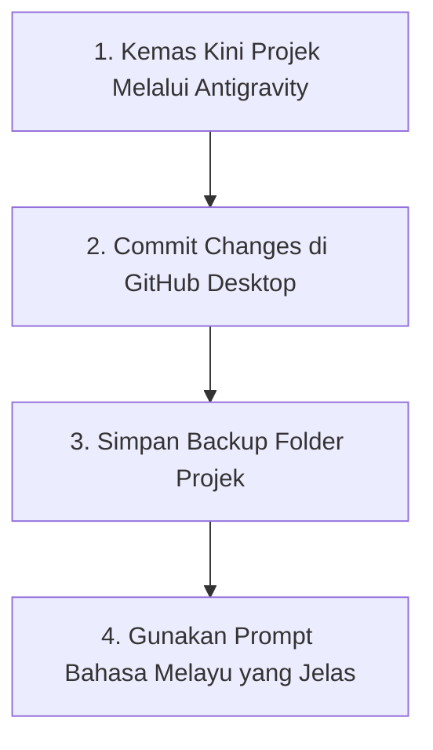

# Bab 15 – Manual Mengemas Kini & Menjaga Laman Web Masa Hadapan

Tahniah! Anda telah menguasai keseluruhan alur kerja membina dan menerbitkan sistem tanpa pengetahuan coding. Bab ini memberikan petua terbaik untuk menguruskan sistem anda di masa hadapan.

---

## 15.1 4 Petua Emas Pengurusan Sistem AI

---

## 15.2 Cara Mengemaskini Laman Web Di Masa Hadapan

Jika anda mahu menambah ciri baharu atau mengubah teks di laman web anda pada kemudian hari:
1. Buka **Antigravity** dan pilih folder projek anda.
2. Taip arahan perubahan di perbualan (contoh: *"Tolong tambah butang WhatsApp di bahagian bawah laman web"*).
3. Selepas Antigravity siap mengemaskini `index.html`, buka aplikasi **GitHub Desktop**.
4. Masukkan mesej ringkas di kotak Summary (contoh: *"Tambah butang WhatsApp"*) dan tekan **Commit to main** -> **Push origin**.
5. Laman web awam anda di GitHub Pages akan dikemaskini secara automatik di internet dalam masa beberapa minit!

---

## 15.3 Rumusan Alur Kerja 6 Langkah Anda
1. **Chat GPT** -> Hasilkan Master Prompt terperinci.
2. **Folder Komputer** -> Sediakan simpanan & salin pautan (*copy path*).
3. **Google Antigravity** -> Tampal Master Prompt & biarkan AI bina sistem.
4. **Semakan Pelayar** -> Dwi-klik `index.html`, uji butang, suruh Antigravity baiki jika ada masalah.
5. **GitHub Desktop & GitHub Pages** -> Muat naik & dapatkan *Live Web Link* awam.

*Selamat Membina Sistem & Website Idaman Anda Bersama Google Antigravity!* 🚀

---
*Tamat Playbook Google Antigravity (Edisi Pengguna Non-Coder).*
